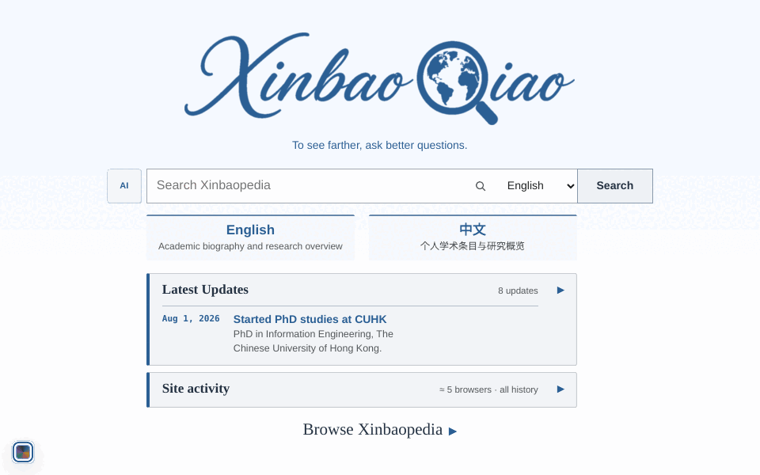
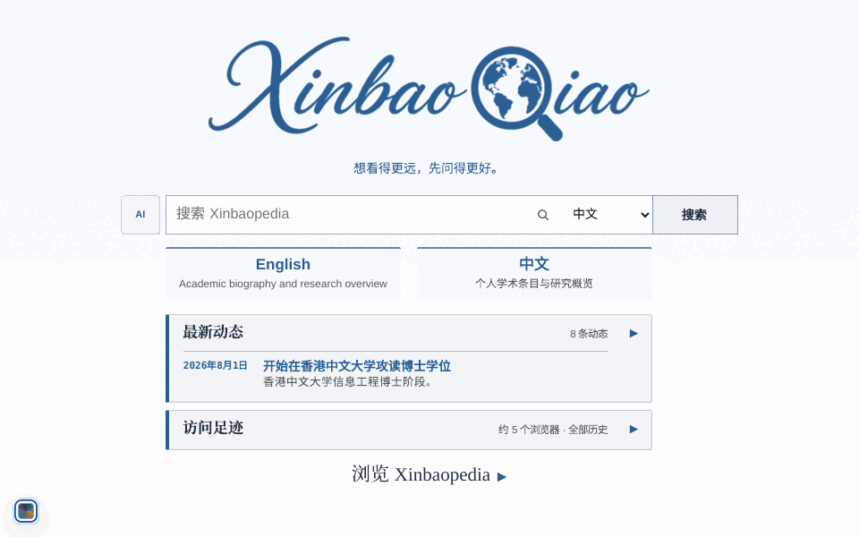

<a id="top"></a>

<p align="center">
  <a href="#english"></a>
  <a href="#simplified-chinese"></a>
</p>

<div align="center">
  

  # XinbaoWiki

  **Bilingual academic homepage as a Wiki you can browse, search, and ask — with citations.**

  **双语学术主页：像 Wiki 一样浏览与搜索，也能带引用追问。**

  <p>
    <a href="https://github.com/XinbaoQiao/XinbaoWiki/tree/template"></a>
    <a href="https://xinbaopedia.top"></a>
  </p>

  <p>
    <a href="https://github.com/XinbaoQiao/XinbaoWiki/actions/workflows/ci.yml"></a>
    <a href="https://github.com/XinbaoQiao/XinbaoWiki/actions/workflows/sync-template.yml"></a>
    <a href="LICENSING.md"></a>
  </p>
</div>

---

<a id="english"></a>

## English

### Branches

| Branch | Role |
| --- | --- |
| [`template`](https://github.com/XinbaoQiao/XinbaoWiki/tree/template) | **Starter for others** — placeholders only (“Your Name”, sample pages, no owner photos) |
| [`main`](https://github.com/XinbaoQiao/XinbaoWiki/tree/main) | **Live site source** for [xinbaopedia.top](https://xinbaopedia.top) |

Want your own site? Use **`template`**, not `main`.

### Use the template

<details>
<summary><strong>1. Open the branch</strong> — GitHub → branch dropdown → <code>template</code></summary>

- Direct link: [github.com/XinbaoQiao/XinbaoWiki/tree/template](https://github.com/XinbaoQiao/XinbaoWiki/tree/template)
- You should see “Your Name” / “Example University”, not a personal CV.

</details>

<details>
<summary><strong>2. Clone only <code>template</code></strong></summary>

```bash
git clone -b template --single-branch https://github.com/XinbaoQiao/XinbaoWiki.git my-wiki
cd my-wiki
```

Already cloned the repo?

```bash
git fetch origin template
git checkout template
```

</details>

<details>
<summary><strong>3. Or fork, then switch to <code>template</code></strong></summary>

1. Fork on GitHub.
2. In your fork, pick branch **`template`** (or branch off it).
3. Clone **your** fork and check that branch out.

Starting from `main` copies personal pages and media. Prefer `template`.

</details>

<details>
<summary><strong>4. Run locally</strong> — Node 22, then <code>npm ci</code> / <code>npm run dev</code></summary>

```bash
# Node 22 (see .nvmrc)
npm ci
npm run dev        # http://localhost:3000
```

Before you deploy:

```bash
npm run maintain:wiki
npm run check
npm run build
```

</details>

<details>
<summary><strong>5. Replace placeholders</strong> — config, wiki pages, public assets, optional env</summary>

| Goal | Edit |
| --- | --- |
| Name, taglines, research areas, chat starters | `lib/site-config.ts` |
| Wiki pages (EN + ZH) | `wiki/*.md` — each `Foo.md` has `Foo_zh.md` |
| Site URL | `NEXT_PUBLIC_SITE_URL` |
| Avatar / icons / figures | `public/` |
| Optional page AI / visitor map | env vars — `docs/chat/README.md`, `docs/site-activity/README.md` |

After Wiki edits:

```bash
npm run maintain:wiki
```

The longer checklist is in the README **on the `template` branch**.

</details>

### Live example

[xinbaopedia.top](https://xinbaopedia.top) runs from `main`. Look there for the product; build yours from `template`.

<p align="center">
  <a href="https://xinbaopedia.top/"></a>
</p>

### What’s inside

Folded = outline. Open a section if you care about that part.

<details>
<summary><strong>A. Home & reading</strong> — wordmark, themes, updates, Wiki article / sidebar / TOC</summary>

- Homepage wordmark with expand / collapse
- Theme palettes (blue / gold / green / charcoal / auto)
- Latest updates (compact / full)
- Wiki articles from `wiki/*.md` with sidebar, TOC, KaTeX, paper cards

Try: [xinbaopedia.top](https://xinbaopedia.top/) · open any `/wiki/...` page

</details>

<details>
<summary><strong>B. Browse & search</strong> — directory, cube view, bilingual search</summary>

- Curated directory of people / topics / papers / institutions
- Browse cube (list ↔ cube)
- Search over titles, aliases, summaries, and body text (EN / 中文)

</details>

<details>
<summary><strong>C. Ask with citations</strong> — optional page AI</summary>

- Answers grounded in the current Wiki page when possible
- Numbered citations you can check
- Falls back to normal chat when the question is off-Wiki
- Needs an OpenAI-compatible endpoint (see `docs/chat/`)

</details>

<details>
<summary><strong>D. Optional extras</strong> — visitor atlas, wallpaper, OKF export</summary>

- Visitor atlas (Upstash Redis; empty map if unset)
- Owner wallpaper / mixed palette (visitors default to mixed)
- `public/okf/**` — agent-readable export regenerated from the Wiki

</details>

<details>
<summary><strong>E. Content model</strong> — how pages are typed and linked</summary>

Rough hierarchy:

```text
Person / Home
├── Research topics
├── Papers & projects
├── Institutions & people
└── Notes / drafts (can be hidden)
```

- One idea per Markdown file; Chinese twin ends with `_zh`
- Links: `[[Wikilinks]]` in the body
- Stronger links: `relations` in frontmatter (`related`, `uses`, `depends-on`, `cites`, …) — see [docs/relation-taxonomy.md](docs/relation-taxonomy.md)
- Writing guide: [docs/content-template.md](docs/content-template.md)

</details>

### How `template` stays current

Every push to `main` runs [Sync template branch](https://github.com/XinbaoQiao/XinbaoWiki/actions/workflows/sync-template.yml):

1. Sanitize `main` (drop personal paths, rewrite owner strings, overlay sample Wiki / images)
2. Leak-check
3. `npm ci` → `check:node22` → `build` in the sanitized tree
4. Update the public `template` branch

Manual run: Actions → **Sync template branch** → Run workflow.  
Check: [tree/template](https://github.com/XinbaoQiao/XinbaoWiki/tree/template) (message like `Sync template from main <sha>`).

<details>
<summary><strong>Repo map</strong></summary>

```text
app/           pages + same-site API
components/    Wiki, search, theme, chat UI
lib/           parsing, retrieval, prompts, navigation
wiki/          bilingual Markdown source
public/okf/    generated agent-readable bundle
scripts/       maintenance, eval, release, template sanitizer (main only)
docs/          content, chat, deployment notes
```

</details>

<details>
<summary><strong>Licensing</strong></summary>

Software: [MIT](LICENSE). Licensable original Wiki/docs text: [CC BY 4.0](LICENSES/CC-BY-4.0.txt). Personal media and third-party assets are excluded — [LICENSING.md](LICENSING.md).

</details>

<p align="right"><a href="#top">Back to top ↑</a></p>

---

<a id="simplified-chinese"></a>

## 简体中文

### 分支

| 分支 | 作用 |
| --- | --- |
| [`template`](https://github.com/XinbaoQiao/XinbaoWiki/tree/template) | **给别人用的起步包** — 只有占位内容（“Your Name”、示例页、无站长照片） |
| [`main`](https://github.com/XinbaoQiao/XinbaoWiki/tree/main) | **线上站源码**，对应 [xinbaopedia.top](https://xinbaopedia.top) |

要搭自己的站，请用 **`template`**，不要直接用 `main`。

### 使用模板

<details>
<summary><strong>1. 打开分支</strong> — GitHub → 分支下拉框 → <code>template</code></summary>

- 直达：[github.com/XinbaoQiao/XinbaoWiki/tree/template](https://github.com/XinbaoQiao/XinbaoWiki/tree/template)
- 应看到 “Your Name” / “Example University”，而不是个人简历。

</details>

<details>
<summary><strong>2. 只克隆 <code>template</code></strong></summary>

```bash
git clone -b template --single-branch https://github.com/XinbaoQiao/XinbaoWiki.git my-wiki
cd my-wiki
```

若已克隆整个仓库：

```bash
git fetch origin template
git checkout template
```

</details>

<details>
<summary><strong>3. 或先 Fork，再切到 <code>template</code></strong></summary>

1. 在 GitHub 点 Fork。
2. 在你的 fork 里选分支 **`template`**（或从它拉出工作分支）。
3. 克隆**你的** fork 并 checkout 该分支。

从 `main` 起步会带上个人 Wiki 与媒体，请优先用 `template`。

</details>

<details>
<summary><strong>4. 本地运行</strong> — Node 22，然后 <code>npm ci</code> / <code>npm run dev</code></summary>

```bash
# 推荐 Node 22（见 .nvmrc）
npm ci
npm run dev        # http://localhost:3000
```

发布前：

```bash
npm run maintain:wiki
npm run check
npm run build
```

</details>

<details>
<summary><strong>5. 换成你的内容</strong> — 配置、Wiki、静态资源、可选环境变量</summary>

| 目标 | 改哪里 |
| --- | --- |
| 姓名、标语、研究方向、聊天开场 | `lib/site-config.ts` |
| Wiki 页面（中英） | `wiki/*.md` — 每个 `Foo.md` 有 `Foo_zh.md` |
| 站点 URL | `NEXT_PUBLIC_SITE_URL` |
| 头像 / 图标 / 配图 | `public/` |
| 可选页内 AI / 访客地图 | 环境变量 — `docs/chat/README.md`、`docs/site-activity/README.md` |

改完 Wiki 后：

```bash
npm run maintain:wiki
```

更完整的清单见 **`template` 分支上的 README**。

</details>

### 线上示例

[xinbaopedia.top](https://xinbaopedia.top) 跑的是 `main`。看效果用它；搭自己的站用 `template`。

<p align="center">
  <a href="https://xinbaopedia.top/"></a>
</p>

### 里面有什么

折叠时 = 大纲。感兴趣再点开。

<details>
<summary><strong>A. 首页与阅读</strong> — 字标、主题、更新、Wiki 正文 / 侧栏 / 目录</summary>

- 首页字标，可展开 / 收起
- 主题色板（蓝 / 金 / 绿 / 炭灰 / 自动）
- 最新更新（紧凑 / 完整）
- `wiki/*.md` 文章：侧栏、目录、KaTeX、论文卡

试一下：[xinbaopedia.top](https://xinbaopedia.top/) · 任意 `/wiki/...` 页

</details>

<details>
<summary><strong>B. 浏览与搜索</strong> — 目录、立方体、双语搜索</summary>

- 人物 / 主题 / 论文 / 机构目录
- Browse 立方体（列表 ↔ 立方体）
- 按标题、别名、摘要、正文搜索（EN / 中文）

</details>

<details>
<summary><strong>C. 带引用的追问</strong> — 可选页内 AI</summary>

- 尽量基于当前 Wiki 页作答
- 带可核对的编号引用
- 超出 Wiki 时退回普通对话
- 需要 OpenAI 兼容接口（见 `docs/chat/`）

</details>

<details>
<summary><strong>D. 可选能力</strong> — 访客地图、壁纸、OKF 导出</summary>

- 访客地图（Upstash Redis；未配置则空图）
- 站长壁纸 / 混合色板（访客默认混合）
- `public/okf/**` — 从 Wiki 生成的 agent 可读包

</details>

<details>
<summary><strong>E. 内容结构</strong> — 页面怎么分类、怎么连</summary>

大致层级：

```text
人物 / 主页
├── 研究主题
├── 论文与项目
├── 机构与人物
└── 笔记 / 草稿（可隐藏）
```

- 一页一事；中文页文件名以 `_zh` 结尾
- 正文链接：`[[Wikilink]]`
- 更稳的关系：frontmatter 里的 `relations`（`related`、`uses`、`depends-on`、`cites` 等）— 见 [docs/relation-taxonomy.md](docs/relation-taxonomy.md)
- 写作说明：[docs/content-template.md](docs/content-template.md)

</details>

### `template` 如何保持更新

每次推送到 `main` 都会跑 [Sync template branch](https://github.com/XinbaoQiao/XinbaoWiki/actions/workflows/sync-template.yml)：

1. 清洗 `main`（去掉个人路径、改写站长文案、覆盖示例 Wiki / 图片）
2. 泄漏检查
3. 在清洗结果里 `npm ci` → `check:node22` → `build`
4. 更新公开的 `template` 分支

手动重跑：Actions → **Sync template branch** → Run workflow。  
确认：[tree/template](https://github.com/XinbaoQiao/XinbaoWiki/tree/template)（说明形如 `Sync template from main <sha>`）。

<details>
<summary><strong>仓库结构</strong></summary>

```text
app/           页面与同站 API
components/    Wiki、搜索、主题、聊天 UI
lib/           解析、检索、提示词、导航
wiki/          双语 Markdown 源
public/okf/    生成的 agent 可读包
scripts/       维护、评测、发布、模板清洗（仅 main）
docs/          内容、聊天、部署说明
```

</details>

<details>
<summary><strong>许可</strong></summary>

软件：[MIT](LICENSE)。可授权的原创 Wiki / 文档文字：[CC BY 4.0](LICENSES/CC-BY-4.0.txt)。个人媒体与第三方素材不在上述统一授权内 — [LICENSING.md](LICENSING.md)。

</details>

<p align="right"><a href="#top">返回顶部 ↑</a></p>
